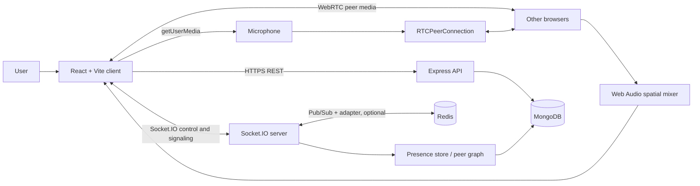

# System Architecture

## High-level context

## Backend startup sequence

`server/src/index.js`:
1. Load and validate environment configuration.
2. Connect to MongoDB.
3. Ensure MongoDB indexes, including the `UserPresence.location` `2dsphere` index.
4. Initialize Redis bus (or single-instance fallback).
5. Create service instances.
6. Ensure the default `lobby` room exists.
7. Create HTTP server and Express application.
8. Attach Socket.IO.
9. Install Socket.IO JWT authentication middleware.
10. Subscribe to cross-instance Redis events.
11. Start runtime maintenance jobs.
12. Listen on configured host and port.
13. On SIGINT/SIGTERM, stop runtime, close Socket.IO, flush presence, close Redis and disconnect MongoDB.

## Frontend structure

| Directory/file | Responsibility |
|---|---|
| `client/src/App.jsx` | Authentication/session boundary, dashboard/office switching and office shell |
| `client/src/components/` | Login, signup, verification, password reset, dashboard, room entry, people, status and audit UI |
| `client/src/components/dashboard/` | Dashboard layout, topbar, sidebar, room list, history, profile, settings, stats and actions |
| `client/src/state/ProxiContext.jsx` | Shared room, roster, socket, microphone, peer and spatial-audio state |
| `client/src/socket/socketClient.js` | Socket.IO client wrapper |
| `client/src/webrtc/PeerManager.js` | Peer connection lifecycle and signaling |
| `client/src/audio/SpatialAudioEngine.js` | Web Audio routing and remote stream processing |
| `client/src/audio/spatialMath.js` | Distance/gain/pan calculations |
| `client/src/audio/occlusion.js` | Obstacle-aware sound attenuation |
| `client/src/canvas/WorldCanvas.jsx` | Canvas world rendering and interaction |
| `client/src/canvas/draw.js` | Drawing primitives and visual world rendering |
| `client/src/canvas/officeLayout.js` | Office layout/geometry definitions |
| `client/src/canvas/physics.js` | Movement/collision physics |
| `client/src/hooks/` | Animation frame, keyboard movement, pointer mapping, UI tick and auth-session hooks |
| `client/src/services/officeBlueprintApi.js` | Office blueprint API integration |
| `client/src/utils/meetingSessionStorage.js` | Validated sessionStorage helper for active meeting intent |

## Backend structure

| Directory/file | Responsibility |
|---|---|
| `server/src/app.js` | Express middleware, REST routes, health/stats/audit and static client serving |
| `server/src/config/index.js` | Central environment parsing, validation and defaults |
| `server/src/db/mongo.js` | MongoDB connection and index setup |
| `server/src/db/redis.js` | Redis connection, Pub/Sub and Socket.IO adapter integration |
| `server/src/middleware/` | JWT authentication and room-access middleware |
| `server/src/routes/` | Authentication, refresh sessions, room creation/access and meeting history |
| `server/src/sockets/` | Socket authentication, room membership, validation, signaling authorization and revocation |
| `server/src/services/` | Room, presence, geospatial, peer graph, obstacle, audit, email, session and blueprint domain logic |
| `server/src/models/` | Mongoose models |
| `server/src/runtime.js` | Presence flush, stale-user sweep, peer reconciliation and cluster refresh |
| `server/src/scripts/` | Seed, spatial audit and load test |

## Communication planes

### REST API
Used for account operations, session lifecycle, room catalogue/creation/access, meeting history, health, runtime stats, blueprint import and spatial audit.

### Socket.IO control plane
Used for joining/leaving rooms, media readiness, presence, movement, peer negotiation/signaling, hangup, obstruction updates and spatial cluster notifications. Socket.IO does not transport the actual audio stream.

### WebRTC media plane
Browser `RTCPeerConnection` instances carry peer media. The server authorizes and relays signaling; media is intended to flow peer-to-peer. The provided ICE config contains STUN only; there is no TURN setting in this archive.

### Spatial audio
Remote streams are mixed locally through Web Audio. Distance affects gain, direction affects stereo pan, and obstacle geometry affects attenuation/occlusion. Audio output is local to each listener.

## Spatial/geospatial model

The server config defines a world width/height in pixels, a geographic center and `PIXELS_PER_METER`. Presence stores both authoritative pixel `x/y` and GeoJSON `location` coordinates `[longitude, latitude]`. A MongoDB `2dsphere` index supports proximity queries. The default config uses a 100 px earshot radius and 10 px per metre, which maps to approximately 10 m at those defaults.

## Authority and trust boundaries

- Server controls room membership, room permissions and authoritative presence.
- Client UI state is not an authorization boundary.
- Socket connections are authenticated before connection handlers run.
- Private room membership is checked by server middleware/services.
- Signaling is authorized against the server's peer graph.
- Redis coordinates cross-instance events; MongoDB stores durable records.
