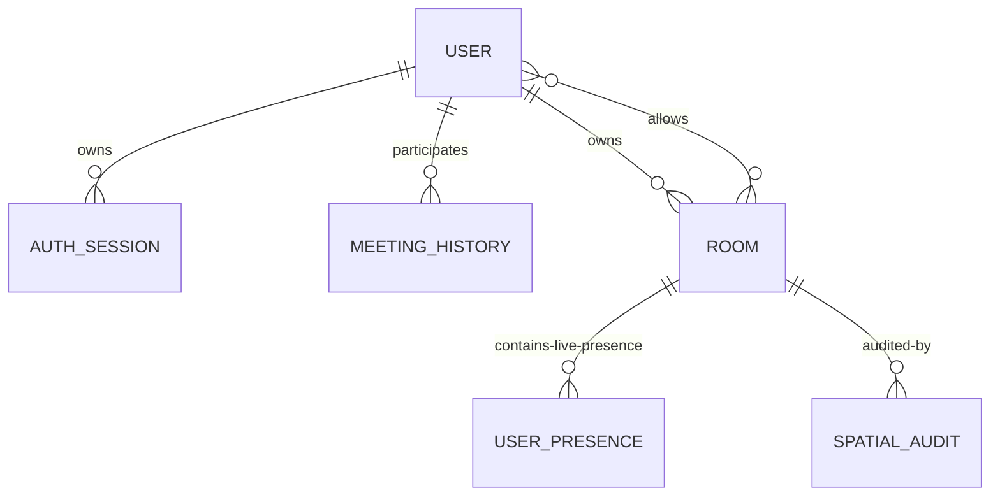

# MongoDB Data Model

Mongoose models are in `server/src/models/`. The following describes the fields and indexes visible in the uploaded source snapshot.

## User

File: `User.js`

| Field | Type / constraints | Purpose |
|---|---|---|
| `username` | String, required, unique, trim, 3–50 | Public account name |
| `email` | String, required, unique, lowercase, valid email, max 254 | Account email |
| `password` | String, required, min 8, `select:false` | bcryptjs hash stored by pre-save hook |
| `isEmailVerified` | Boolean, default false, indexed | Verification gate |
| `emailVerificationOtpHash` | String, hidden | Verification OTP hash |
| `emailVerificationOtpExpiresAt` | Date, hidden | Verification OTP expiry |
| `emailVerificationOtpLastSentAt` | Date, hidden | Resend cooldown tracking |
| `passwordResetOtpHash` | String, hidden | Password reset OTP hash |
| `passwordResetOtpExpiresAt` | Date, hidden | Password reset OTP expiry |
| `passwordResetOtpLastSentAt` | Date, hidden | Reset resend cooldown tracking |
| timestamps | createdAt/updatedAt | Mongoose timestamps |

Password hashing uses bcryptjs with cost factor 12. Password comparison is exposed through `comparePassword`.

## AuthSession

File: `AuthSession.js`

- `userId`: required ObjectId reference to User, indexed.
- `tokenHash`: required, unique, hidden from normal selection.
- `expiresAt`: required Date with TTL index (`expireAfterSeconds: 0`).
- `lastUsedAt`: Date.
- Compound index `{ userId: 1, expiresAt: 1 }`.

The raw refresh token is not stored as the durable database value; the model stores its hash.

## Room

File: `Room.js`

- `roomId`: required, unique, lowercase string.
- `name`: required, default `Unnamed Office`, max 80.
- `description`: max 500.
- `visibility`: `public` or `private`, default public.
- `ownerId`: optional User ObjectId; required by validation for private rooms.
- `allowedUsers`: User ObjectId array.
- `width`, `height`: finite numbers, minimum 200.
- `obstacles`: embedded geometry (`id`, type, x/y/w/h, `blocksAudio`, `attenuation`).
- `spawnPoints`: embedded x/y points.
- timestamps.

Obstacle types: `wall`, `desk`, `plant`, `pillar`, `screen`. Obstacle geometry and spawn points must fit inside the room bounds. Attenuation is between 0 and 1.

## UserPresence

File: `UserPresence.js`

- `sessionId`, `instanceId`, `roomId`.
- Participant name, color, avatar.
- Authoritative pixel `x`, `y`, angle.
- GeoJSON `location` Point with coordinates `[longitude, latitude]`.
- `micEnabled`, `lastSeen`, `createdAt`/`updatedAt`.

Indexes:
- `location: 2dsphere` for geospatial queries.
- Unique `{ sessionId: 1, roomId: 1 }`.
- `{ roomId: 1, lastSeen: -1 }`.

## MeetingHistory

File: `MeetingHistory.js`

- `userId`, `sessionId`, `roomId`.
- Room name and username snapshots.
- `role`: `host` or `participant`.
- `status`: `active`, `completed` or `abandoned`.
- `startedAt`, `endedAt`, `lastSeenAt`.
- `durationSeconds`, `participantCountAtJoin`.
- Unique `{ userId: 1, sessionId: 1 }`.
- Dashboard index `{ userId: 1, startedAt: -1 }`.
- Room history index `{ roomId: 1, startedAt: -1 }`.
- Stale-session index `{ status: 1, lastSeenAt: 1 }`.

## SpatialAudit

File: `SpatialAudit.js`

Stores room ID, source (`http`, `cli`, `scheduler`), trigger, budget, min/average/p95/max timings, matched count, index name, within-budget result, details, instance ID and creation time. Indexed by `{ roomId: 1, createdAt: -1 }`.

## Relationship overview

Presence is live/session-oriented; MeetingHistory is durable per-user meeting history. Room access is represented by owner and allowed-user references.
