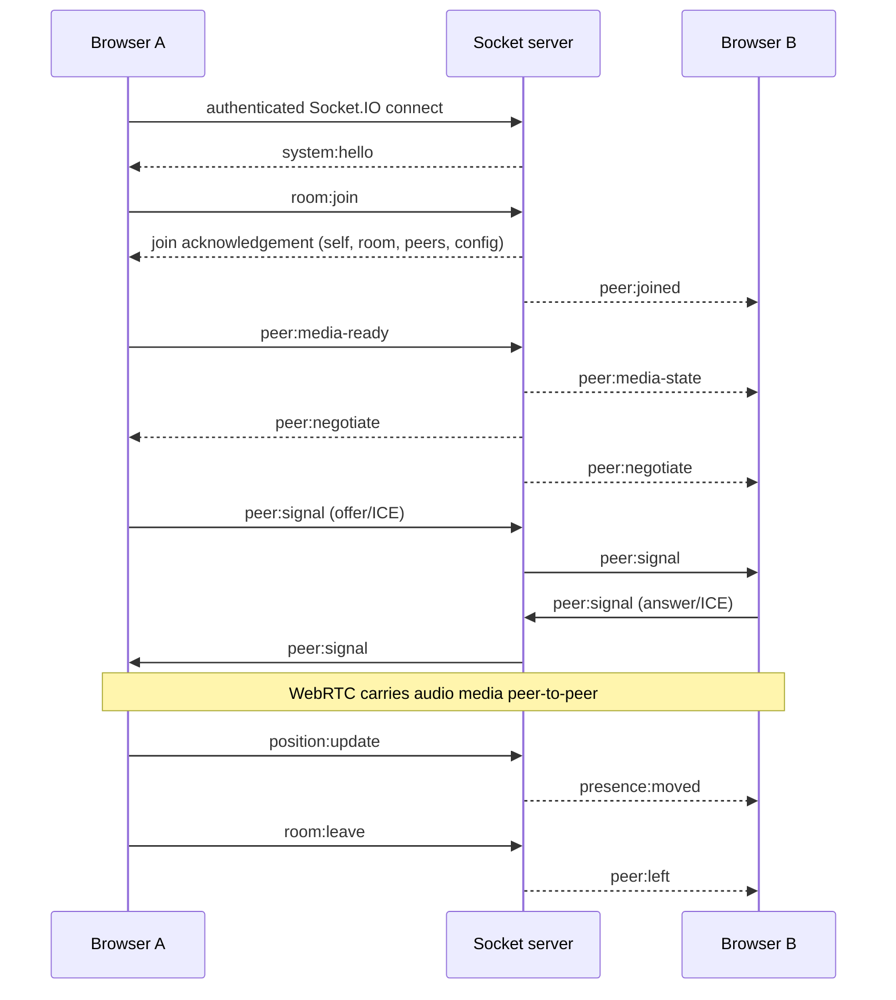

# Socket.IO Event Reference

Socket.IO is the real-time control and signaling channel. The actual WebRTC media stream is not carried in Socket.IO messages.

## Authentication and connection

The server installs JWT Socket.IO authentication middleware in `server/src/index.js` before socket connection handlers are registered. A connection receives `system:hello` with server information. Invalid/expired authentication is rejected by the middleware; see `server/src/sockets/authentication.js` and `client/src/socket/socketClient.js` for the exact token transport.

## Client → server events found in the server handlers

| Event | Purpose |
|---|---|
| `room:join` | Request entry into a room; server validates identity, room and access |
| `room:leave` | Leave current room and close associated participant lifecycle |
| `peer:media-ready` | Publish whether the local participant has enabled microphone media |
| `position:update` | Submit avatar position/angle for server validation and presence broadcast |
| `presence:heartbeat` | Keep presence active |
| `presence:request-sync` | Request a fresh room presence snapshot |
| `peer:signal` | Relay WebRTC offer/answer/ICE signaling through server authorization |

## Server → client events found in the server/services/runtime

| Event | Purpose |
|---|---|
| `system:hello` | Server handshake/config/instance information |
| `system:error` | Structured socket error |
| `peer:joined` | Participant joined the room |
| `peer:left` | Participant left or was removed |
| `peer:media-state` | Participant microphone enabled state changed |
| `presence:moved` | Participant movement update |
| `presence:snapshot` | Room presence snapshot |
| `peer:negotiate` | Peer graph requests a WebRTC negotiation |
| `peer:signal` | Relayed WebRTC signaling payload |
| `peer:hangup` | Peer edge should be closed |
| `peer:audio-obstruction` | Obstacle-derived audio factor changed |
| `presence:clusters` | Updated proximity clusters |
| `audit:completed` | Spatial audit completed for a room |
| `audit:remote` | Audit completion received from another instance |
| `mesh:stats` | Runtime peer-mesh statistics broadcast |

## Typical room and media lifecycle

## Important invariants

1. The server is authoritative for room membership and private-room authorization.
2. Room-scoped events require active membership.
3. Position updates are validated and bounded server-side.
4. Signaling is authorized against the peer graph.
5. Peer graph generations protect against stale negotiation/signaling.
6. Peer edges should reflect proximity policy, not merely roster presence.
7. `peer:media-ready` and `peer:media-state` describe microphone readiness; they do not guarantee audible media.
8. WebRTC connection state and microphone state are separate signals.
9. On reconnect, restore membership through the server; do not trust a stale client roster.
10. Do not rename events or change payload shape without updating both client and server tests.

## Debugging

- Browser DevTools → Network → WS: inspect Socket.IO transport.
- Confirm `system:hello` after connection.
- Confirm the `room:join` acknowledgement and room membership.
- Confirm `peer:media-ready` reaches the server and `peer:media-state` reaches the other participant.
- Confirm `peer:negotiate`, `peer:signal` and `peer:hangup` align with peer graph edges.
- Never log access tokens, refresh tokens, cookies, OTPs or passwords.
